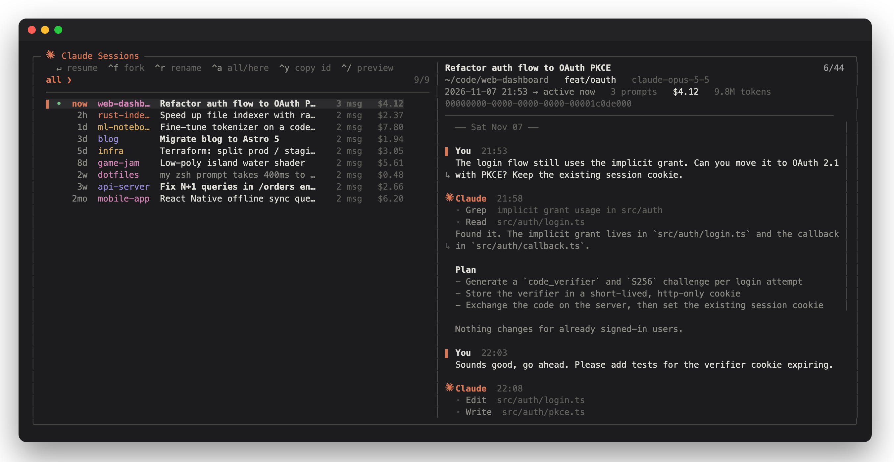

# claude-sessions

**Find, preview and resume your Claude Code sessions from one terminal picker.**

When you exit Claude Code you get a session id and not much else. `claude --resume` only lists the
current folder. `cc-sessions` lists sessions from every project, shows the whole conversation in a
preview pane, and drops you back into the right directory when you pick one.



<sub>Screenshot uses generated demo data (`scripts/make-demo.py`).</sub>

## Features

- **Every project in one list.** Sessions are sorted by last activity. Each row shows a live marker, the age, the project, the title, the message count and the cost.
- **Readable titles.** Your `/rename` names are shown in bold and Claude's auto titles in normal weight. Untitled sessions fall back to the first prompt, shown dimmed.
- **Conversation preview.**
  - The header shows the title, directory, git branch, model, time span, cost and total tokens.
  - Below it come your prompts and Claude's replies, with day separators.
  - Tool calls are folded into one line each and slash commands show as `› /cmd`.
- **One-key actions.** You can resume, fork, rename, copy the id and switch between all projects and the current folder.
- **Fast.** An incremental index in `~/.cache/cc-sessions` re-reads only what changed. On the author's machine, 250 MB of transcripts indexed in under a second the first time; after that the list opened in about 40 ms.
- **Matches your theme.** It follows Claude Code's light/dark theme, or the macOS appearance when the theme is set to `auto`.
- **Few dependencies.** It is a single Python 3 file with no packages to install, and uses [fzf](https://github.com/junegunn/fzf) for the UI.

## Install

```sh
brew install fzf            # if you don't have it
git clone https://github.com/PixelCookie-zyf/claude-sessions.git
cd claude-sessions && ./install.sh
```

`install.sh` does two things:
- It symlinks `cc-sessions` into `~/.local/bin`.
- It installs the small `ClaudeMark` font used for the logo. Use `./install.sh --no-font` to skip the font; the UI then uses `✻` instead.

Requirements: Python 3.8+ and a recent fzf (developed with fzf 0.74). Built and tested on macOS. On Linux the core works, but copying the id uses `pbcopy` and theme detection reads macOS settings.

## Usage

| command | what it does |
|---|---|
| `cc-sessions` | open the picker with sessions from every project |
| `cc-sessions .` | only sessions started in this folder (or below it) |
| `cc-sessions ls` | print a plain table and exit, without the UI |
| `cc-sessions -h` | help |

### Keys

| key | action |
|---|---|
| type | fuzzy-search titles and project names |
| `enter` | `cd` into the project and run `claude --resume <id>` |
| `ctrl-f` | fork: resume into a new session id (`--fork-session`) |
| `ctrl-r` | rename the session, the same way `/rename` does |
| `ctrl-a` | toggle between all projects and the current folder |
| `ctrl-y` | copy the session id |
| `ctrl-/` | toggle the preview |
| `shift-↑/↓` | scroll the preview |
| `alt-↑/↓` | jump to the top or bottom of the preview |
| `esc` | quit |

The preview sits beside the list in wide terminals and moves below it in narrow ones.

### Environment

| variable | default | purpose |
|---|---|---|
| `CC_SESSIONS_PROJECTS` | `~/.claude/projects` | where Claude Code keeps transcripts |
| `CC_SESSIONS_CACHE` | `~/.cache/cc-sessions` | index and preview cache |
| `CC_SESSIONS_THEME` | follows Claude Code | force `dark` or `light` |
| `CC_SESSIONS_ICON` | Claude mark or `✻` | override the logo glyph |

## How it works

Claude Code stores each session as a JSONL transcript under `~/.claude/projects/<folder>/<id>.jsonl`.
`cc-sessions` reads these files without changing them:

- It takes the working directory and git branch from user messages.
- It takes the titles from `custom-title` (written by `/rename`) and `ai-title` entries.
- It takes the cost and token totals from the last `cost-state` entry.

**Renaming** appends one `{"type":"custom-title",…}` line to the transcript, which is the same entry
`/rename` writes. Renaming a session that is still running may be overwritten by that session, so
`cc-sessions` warns you and suggests using `/rename` inside it instead.

The transcript format is internal to Claude Code and may change between versions. If something
looks off after an update, please open an issue.

## Demo data

```sh
python3 scripts/make-demo.py /tmp/cc-demo
CC_SESSIONS_PROJECTS=/tmp/cc-demo CC_SESSIONS_CACHE=/tmp/cc-demo-cache ./cc-sessions
```

## Credits

- The logo glyph comes from [Bootstrap Icons](https://icons.getbootstrap.com/icons/claude/) (MIT). It is repackaged as a one-glyph font at U+10F914; see `fonts/LICENSE-bootstrap-icons`.
- Claude and the Claude logo are trademarks of Anthropic. This project is not affiliated with or endorsed by Anthropic.

## License

[MIT](LICENSE)
